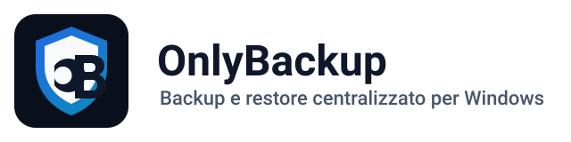

<p align="center">
  
</p>

# OnlyBackup

Centralized backup management for Windows environments. A Node.js server with a web dashboard and REST API schedules and monitors backup jobs, while a C# agent running as a Windows service executes them on each client.

## Features

- **Web dashboard and API**: Express server serving a static dashboard, with pages for alerts, server settings and email settings.
- **Scheduled jobs**: job scheduler on the server, manual runs, run logs, backup analysis and retention handling.
- **Windows agent**: .NET Framework 4.6.2 agent that runs as a Windows service or in console mode and performs backups with a filesystem/robocopy engine, including network share handling.
- **Monitoring and alerts**: agent heartbeat, offline detection, active alerts and history.
- **Email notifications**: SMTP with templates and OAuth sign-in for Google and Microsoft (the OAuth apps must be configured by the operator).
- **Authentication**: users, sessions and a forced password change on first login.
- **Windows packaging**: PowerShell scripts for server setup, Windows service wrapper, self-contained server package, optional Inno Setup installer and agent MSI (WiX 3.14).

## Requirements

- Windows (the only supported platform).
- Node.js `>= 20.19.0` and npm for the server.
- .NET Framework 4.6.2 to run the agent; Developer Pack and MSBuild to build it.
- WiX Toolset 3.14 for the agent MSI; Inno Setup 6.x only for the optional server installer.

## Quick start

From the repository root, on PowerShell:

```powershell
powershell -ExecutionPolicy Bypass -File .\scripts\Setup-OnlyBackupServer.ps1 -InitialAdminPassword "<choose-a-password>"
Set-Location .\server
npm start
```

The dashboard is available at `http://localhost:8080/`. Configuration is read from `config.json` in the repository root, or from the path in `CONFIG_PATH`. Without `-InitialAdminPassword` a random admin password is generated and printed to the console.

Build the agent MSI:

```powershell
powershell -ExecutionPolicy Bypass -File .\scripts\Build-AgentMsi.ps1 -UseLocalhost
```

Run the agent manually with `OnlyBackupAgent.exe /console`, or register it as a service with `OnlyBackupAgent.exe /install`.

## Tests

```powershell
Set-Location .\server
npm test          # end-to-end server smoke test with a fake agent
npm run test:ui   # Playwright browser smoke test
```

`scripts\Invoke-RepositoryGate.ps1` runs the local gate (script and JSON parsing, preflight, server smoke test, MSI packaging).

## Repository layout

| Path | Content |
| --- | --- |
| `server/` | Node.js server, dashboard (`public/`) and Windows service wrapper |
| `agent/` | C# agent (`OnlyBackupAgent.sln`) |
| `scripts/` | Setup, packaging, validation and cleanup scripts |
| `docs/` | Project specification, end-user setup guide, assets and detailed operations guide |

## Documentation

Detailed documentation is written in Italian:

- [Operations guide](docs/OPERATIONS.it.md): setup, build, run, packaging, supported commands, cleanup
- [End-user setup](docs/SETUP_UTENTE_FINALE.md)
- [Project specification](docs/PROJECT_SPEC.md)
- [Assets and brand kit](docs/ASSETS.md)

## Security

OAuth client secrets and the initial admin password are supplied by the operator through `config.json` or environment variables and are never stored in the repository. See [SECURITY.md](SECURITY.md) to report a vulnerability.

## License

Proprietary, all rights reserved. See [LICENSE](LICENSE). Third-party npm components are listed in [CREDITS.md](CREDITS.md).
